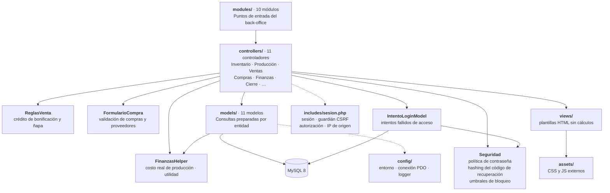
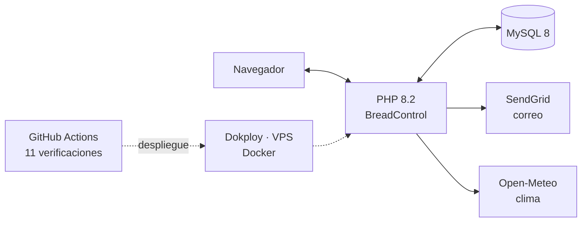

# 🍞 BreadControl

**Sistema de Gestión Integral para Panaderías Artesanales**

BreadControl es una aplicación web diseñada específicamente para digitalizar y optimizar la operación diaria de panaderías artesanales colombianas: inventario de ingredientes por lotes, recetas, producción, ventas y cierre de caja, todo en un solo lugar.

> 🌐 **Demo en vivo:** [breadcontrol.manuelcardenas.online](https://breadcontrol.manuelcardenas.online)

[](https://github.com/Manuel151025/breadcontrol/actions/workflows/ci.yml)
[](LICENSE)
[](composer.json)
[](CHANGELOG.md)

---

## 📋 Tabla de Contenido

- [Características](#-características)
- [Módulos](#-módulos)
- [Tecnologías](#-tecnologías)
- [Arquitectura](#-arquitectura)
- [Instalación](#-instalación)
- [Configuración inicial en un despliegue nuevo](#️-configuración-inicial-en-un-despliegue-nuevo)
- [Estructura del Proyecto](#-estructura-del-proyecto)
- [Base de Datos](#-base-de-datos)
- [Pruebas](#-pruebas)
- [Integración Continua](#-integración-continua)
- [Seguridad](#-seguridad)
- [Contribuir](#-contribuir)
- [Autor](#-autor)
- [Licencia](#-licencia)

---

## ✨ Características

- **Inventario en tiempo real** con alertas de stock bajo y método FIFO para insumos.
- **Ajustes de inventario** automáticos y transaccionales con re-cálculo de lotes activos.
- **Producción inteligente** con descuento automático de insumos, costeo real por tanda y distribución por categoría de precio.
- **Ventas por categoría de precio** ($500, $1,000, $2,000, $3,000, $5,000) con precio personalizado.
- **Carrito tipo MercadoLibre** para detallar pedidos grandes con fotos de variedades de pan.
- **Bonificación 20% automática** para tiendas con distribución detallada por variedad.
- **Ñapa configurable** por variedad en pedidos detallados.
- **Tres tipos de salida:** Venta (genera ingreso), Bonificación (pan regalado), Consumo interno (empleados).
- **Control de merma** del 6% automático para harina de trigo en las compras ingresadas.
- **Cierre del día** con observaciones que aparecen como banner al día siguiente en el tablero principal.
- **Finanzas** con gráficos, KPIs y exportación a PDF.
- **Clima en tiempo real** integrado con la API de Open-Meteo.
- **Responsive** — funciona en PC, tablet y celular de manera fluida.
- **Cierre de sesión por inactividad**: 6 minutos en el navegador; en el servidor, la sesión caduca a las 8 horas.

---

## 📦 Módulos

| # | Módulo | Descripción |
|---|--------|-------------|
| 1 | **Tablero** | KPIs del día, gráfico de ventas de 7 días, clima, acciones rápidas, banner de observaciones |
| 2 | **Inventario** | CRUD de insumos, alertas de stock bajo, barras visuales de nivel, ajuste manual y eliminación masiva |
| 3 | **Producción** | Registro por tandas, descuento FIFO de lotes, costeo real, distribución por categoría de precio |
| 4 | **Ventas** | Venta rápida + carrito detallado, bonificación automática para tiendas (20%), ñapas, consumo interno |
| 5 | **Recetas** | Catálogo de productos, ingredientes por receta, variedades de pan con imagen y vigencias |
| 6 | **Compras** | Registro simplificado por bolsas, lotes FIFO automáticos, alerta de variación de precio >5% |
| 7 | **Finanzas** | Ingresos vs compras, utilidad bruta/neta, margen, gráficos mensuales/anuales, exportar PDF |
| 8 | **Gastos** | Registro de gastos operativos diarios por categorías (servicios, compras, otros) |
| 9 | **Cierre del día** | Cuadre de caja, observaciones para el tablero al día siguiente, historial de cierres |

**Módulos adicionales:**
- **Perfil de usuario** — Datos personales, cambiar contraseña, configurar PIN de recuperación
- **Recuperar contraseña** — Por correo electrónico (PHPMailer SMTP) o código PIN de 6 dígitos
- **Gestión de clientes y tiendas** — Clientes tipo tienda con bonificación y contacto
- **Variedades de pan** — CRUD con imagen para detallar pedidos del carrito

---

## 🛠 Tecnologías

| Capa | Tecnología |
|------|-----------|
| **Backend** | PHP 8.2, verificado también en 8.3 (MVC modular sin framework) |
| **Base de datos** | MySQL 8 |
| **Frontend** | HTML5, CSS3 (custom, sin framework), JavaScript vanilla |
| **Iconos** | Bootstrap Icons |
| **Fuentes** | Google Fonts (Fraunces, Plus Jakarta Sans, Playfair Display, DM Sans) |
| **Gráficos** | Chart.js (finanzas), CSS bars (tablero) |
| **Email** | PHPMailer 6.9 (SMTP SSL/TLS) |
| **Clima** | API Open-Meteo |
| **Hosting** | VPS con Docker, desplegado con Dokploy desde la rama `main` |
| **Dependencias** | Composer |
| **Pruebas** | PHPUnit 11 (unitarias + integración), Infection (mutación), Playwright (extremo a extremo) |
| **Análisis estático** | PHPStan **nivel 10** (niveles 1-8 corregidos; 9-10 con baseline) |
| **Cobertura y calidad** | PCOV, PHPMD, PHPMetrics |
| **Seguridad (CI)** | `composer audit`, Gitleaks, Semgrep, Snyk (opcional) |
| **CI** | GitHub Actions (11 verificaciones por push/PR) |
| **Gestión** | Jira (Scrum), GitHub |

---

## 🏗 Arquitectura

> **Más diagramas** en [`docs/diagramas.md`](docs/diagramas.md): modelo
> entidad-relación e integración continua.

### Componentes y responsabilidades



**Cómo se lee este diagrama:** las flechas continuas son dependencias de uso; las punteadas, servicios de infraestructura que atraviesan todas las capas. Los helpers (`ReglasVenta`, `FormularioCompra`, `FinanzasHelper`, `Seguridad`) son **funciones puras**: no tocan la base ni la sesión, y por eso se prueban directamente. `IntentoLoginModel` es la excepción deliberada dentro de la seguridad — necesita persistir los intentos, porque un contador en sesión lo esquiva quien borre su cookie.

| Capa | Responsabilidad única | Lo que **no** puede hacer |
|---|---|---|
| **Puntos de entrada** (`modules/`) | Recibir la petición e instanciar su controlador | Contener lógica: son 10 líneas cada uno |
| **Controladores** | Validar la entrada, orquestar el flujo y elegir la vista | Consultar la base de datos directamente |
| **Reglas de negocio** (`helpers/`) | Decidir según las reglas del negocio. Funciones **puras**: sin base de datos ni sesión | Leer o escribir datos |
| **Modelos** (`models/`) | Único punto de acceso a la base, siempre con consultas preparadas | Imprimir HTML o redirigir |
| **Vistas** (`views/`) | Presentar datos ya calculados y escaparlos con `htmlspecialchars` | Calcular reglas de negocio |
| **Infraestructura** (`config/`, `includes/`) | Sesión, guardián CSRF, conexión, registro de errores y correo | Conocer reglas del dominio |

**Por qué las reglas viven aparte:** `ReglasVenta` es la fuente única del crédito de bonificación y ñapa; `FormularioCompra`, de lo que se acepta al registrar una compra o un proveedor; `Seguridad`, de la política de contraseña y del tratamiento de los códigos de recuperación. Antes esas reglas estaban duplicadas —con cuatro mínimos de contraseña distintos, por ejemplo— y las copias se desviaban entre sí. Al ser funciones puras se prueban directamente, sin base de datos: son las que sostienen buena parte de las 193 pruebas.

**Dónde vive la protección CSRF:** el guardián `requerir_csrf()` se invoca **una vez por método de controlador que procesa POST, antes de resolver qué acción se pidió**. Es una decisión de diseño, no un detalle: colocarlo dentro de cada rama `if (isset($_POST['accion']))` habría dejado la protección a merced de que quien añada una acción nueva se acuerde de repetirla.

### Infraestructura y servicios externos



**Patrón:** MVC modular. Cada módulo entra por un archivo mínimo que delega en su controlador.

**Método de inventario:** FIFO (*First In, First Out*) — los lotes más antiguos se consumen primero, de forma transaccional y con costeo real por lote.

**Producción:** las unidades producidas se distribuyen por categoría de precio, lo que permite calcular el stock disponible del día como *producido − vendido*.

---

## 🚀 Instalación

### Requisitos
- PHP 8.2 o superior, con `pdo_mysql`
- MySQL 8.0 o superior (en desarrollo también funciona MariaDB 10.4, pero el CI y producción usan MySQL 8)
- Servidor web (Apache o Nginx), o Docker con el `docker-compose.yml` del repositorio

### Pasos

1. **Clonar el repositorio e instalar dependencias**
   ```bash
   git clone https://github.com/Manuel151025/breadcontrol.git
   cd breadcontrol
   composer install
   ```

2. **Configurar la base de datos**

   Para una **base nueva** basta con el esquema versionado, un volcado sin datos
   de la base de producción (24 tablas y 6 vistas):
   ```bash
   mysql -u root panaderia_bd < sql/init/01_esquema_base.sql
   ```

   **Con Docker:** `docker-compose.yml` monta ese mismo archivo en
   `docker-entrypoint-initdb.d`, y MySQL lo ejecuta al crear el contenedor con un
   volumen vacío.

   Las semillas `sql/init/90_semilla_ci.sql` y `95_semilla_e2e.sql` son solo para
   el CI y las pruebas de navegador: crean cuentas con contraseña conocida. **Nunca
   en producción.**

   **Para una base ya desplegada** (por ejemplo, el VPS), las migraciones de
   `sql/migraciones/` se aplican a mano y en orden de fecha. Para saber cuáles le
   faltan:
   ```bash
   php scripts/migraciones.php                          # qué falta
   php scripts/migraciones.php --marcar=ARCHIVO.sql     # registrar una ya aplicada
   ```
   El script no las aplica él mismo a propósito: en MySQL cada sentencia DDL hace
   commit implícito y una migración a medias no se puede deshacer.

   Migraciones existentes:
   - `2026-07-23_01_normalizar_estado_pago_pedido.sql`
   - `2026-07-23_02_foreign_keys_flujo_pedido_pago.sql`
   - `2026-07-23_03_default_estado_pago_no_aplica.sql`
   - `2026-07-23_04_codigo_aprendiz.sql`
   - `2026-07-23_05_id_cliente_adso.sql`
   - `2026-07-23_06_aprobado_instructor_default_0.sql`
   - `2026-07-24_01_email_unico_cliente.sql`
   - `2026-08-06_01_seguridad_login_y_codigo.sql`
   - `2026-08-06_02_eliminar_id_tienda_destino.sql`
   - `2026-08-20_01_control_migraciones.sql` — crea la tabla `migracion`, que registra qué se aplicó
   - `2026-11-13_01_retirar_portal_clientes.sql` — elimina las tablas y columnas del
     antiguo portal de clientes. **Borra datos:** respaldo antes, y solo después de
     desplegar el código sin portal (el detalle está en el propio archivo).

   Las migraciones de julio y agosto pertenecen al portal de clientes, ya retirado; se
   conservan porque son la historia de las bases existentes.

3. **Configurar entorno y credenciales**
   - Crear un archivo `.env` en la raíz (usando `.env.example` como base) y completar:
     * `APP_ENV` (`local` o `production`) y `APP_URL`
     * `DB_HOST`, `DB_NAME`, `DB_USER`, `DB_PASS`
     * `SMTP_HOST`, `SMTP_PORT`, `SMTP_USER`, `SMTP_PASS`
   - Las variables de entorno **reales** (del sistema, Docker o CI) tienen prioridad sobre `.env`.

4. **Acceder al sistema**
   - Abrir en el navegador: `https://tu-dominio.com/login.php`

---

## 📁 Estructura del Proyecto

```
BreadControl/
├── config/
│   ├── app.php              # Configuración general (URL, sesión, timezone)
│   ├── db.php               # Conexión PDO a MySQL
│   ├── env.php              # Carga de variables de entorno (.env)
│   └── logger.php           # Gestor de logs de errores
│
├── controllers/             # Controladores MVC
│   ├── AuthController.php
│   ├── CompraController.php
│   ├── FinanzasController.php
│   └── ...
│
├── models/                  # Modelos de base de datos
│   ├── AuthModel.php
│   ├── InventarioModel.php
│   ├── IntentoLoginModel.php    # Intentos fallidos de acceso (anti fuerza bruta)
│   └── ...
│
├── helpers/                 # Lógica de negocio pura y reutilizable
│   ├── ReglasVenta.php      # Crédito de bonificación (tiendas) y ñapa (mostrador)
│   ├── FormularioCompra.php # Validación de compras y proveedores
│   ├── FinanzasHelper.php   # Costo real de producción y utilidad
│   ├── ExportadorCsv.php    # Exportaciones a Excel
│   └── Seguridad.php        # Política de contraseña, hashing del código, umbrales
│
├── includes/
│   ├── sesion.php           # Sesión, guardián CSRF, auto-logout, IP de origen
│   ├── entrada.php          # Normaliza $_GET/$_POST antes de los controladores
│   ├── funciones.php        # Helpers (formato, lote FIFO, stock dinámico)
│   └── mailer.php           # Enlace SMTP con PHPMailer
│
├── modules/                 # Puntos de entrada (Entrypoints) por módulo
│   ├── tablero/             # Dashboard principal
│   ├── inventario/          # Gestión de insumos y ajustes
│   ├── produccion/          # Registro de producción y distribución
│   ├── ventas/              # Ventas rápidas y carrito detallado
│   └── ...
│
├── views/                   # Vistas HTML/CSS/JS organizadas por entidad
│   ├── layouts/             # Cabecera, Navbar y Pie de página comunes
│   ├── inventario/          # Plantillas de CRUD e historial
│   └── ...
│
├── assets/
│   ├── css/                 # Hojas de estilo estructuradas por módulo
│   ├── js/                  # Scripts de interacción del frontend
│   └── img/                 # Recursos gráficos y fotos de variedades
│
├── sql/                     # Migraciones y scripts de base de datos
│   ├── init/                # Esquema base versionado + semilla de CI
│   └── migraciones/         # Scripts incrementales por fecha
│
├── tests/                   # Suite de pruebas PHPUnit
│   ├── Unit/                # Unitarias (sin base de datos)
│   └── Integration/         # Integración (transacción + rollback)
│
├── e2e/                     # Recorridos de navegador (Playwright + axe)
├── docs/                    # Diagramas, estrategia de pruebas, mantenimiento, respaldos
├── scripts/                 # Estado de migraciones, datos de demostración, verificaciones
│
├── .github/workflows/       # Integración continua (ci.yml)
├── composer.json            # Metadatos, dependencias y scripts de prueba
├── phpunit.xml              # Configuración de PHPUnit
├── phpstan.neon.dist        # Configuración de PHPStan (nivel 10)
├── login.php                # Inicio de sesión del personal
├── logout.php               # Cierre de sesión
├── recuperar_pin.php        # Recuperación de clave por PIN
├── index.php                # Landing page pública
├── CHANGELOG.md             # Historial de versiones
├── CONTRIBUTING.md          # Guía de contribución
├── LICENSE                  # Licencia MIT
└── README.md
```

---

## 🗃 Base de Datos

### Tablas (24) y vistas (6)

Las relaciones están dibujadas en el [modelo entidad-relación](docs/diagramas.md#1-modelo-entidad-relación).

| Tabla | Descripción |
|-------|-------------|
| `configuracion` | Parámetros globales (una sola fila): márgenes, merma, stock de seguridad |
| `intento_login` | Intentos fallidos de acceso y de recuperación, para el límite anti fuerza bruta |
| `ajuste_inventario` | Ajustes manuales de stock con cantidad antes y después, y motivo |
| `alerta` | Alertas generadas por los módulos (stock, precios) y su atención |
| `proyeccion_caja` | Proyección semanal de ingresos, gastos y saldo |
| `migracion` | Control de migraciones aplicadas (la crea `2026-08-20_01_control_migraciones.sql`) |
| `usuario` | Usuarios del sistema con contraseñas bcrypt, rol y PIN de recuperación |
| `insumo` | Insumos de producción con stock actual y punto de reposición |
| `lote` | Lotes de insumos FIFO con cantidad disponible y precio de entrada |
| `producto` | Catálogo de productos (unidades por tanda) |
| `receta` | Recetas vigentes vinculadas a productos |
| `receta_ingrediente` | Ingredientes por receta con cantidad por tanda y flag de merma |
| `produccion` | Registro histórico de producciones diarias con costeo real |
| `produccion_precio` | Distribución de unidades producidas por categoría de precio |
| `consumo_lote` | Registro de consumo detallado por lote para costeo FIFO |
| `categoria_precio` | Rangos de precios parametrizables para venta rápida |
| `variedad_pan` | Subproductos o variedades de pan con foto |
| `venta` | Registro maestro de ventas (mostrador, tiendas, consumos internos) |
| `venta_detalle` | Detalle estructurado de pedidos por variedad |
| `cliente` | Clientes del punto de venta: tiendas que compran al por mayor y mostrador |
| `proveedor` | Proveedores de insumos y datos de contacto |
| `compra` | Registro de compras con lotes autogenerados |
| `historial_precio` | Registro de variación de precios por insumo y proveedor |
| `gasto` | Egresos operativos diarios del propietario |
| `cierre_dia` | Cuadre de caja diario con utilidades y sugerencias |

**Vistas:** `v_inventario_actual`, `v_insumos_alerta`, `v_lotes_fifo`,
`v_margen_productos`, `v_resumen_financiero_30d` y `v_stock_productos_hoy`.

---

## 🧪 Pruebas

El proyecto usa **PHPUnit 11** con dos suites (193 pruebas, 357 aserciones), más **18 recorridos de navegador** con Playwright:

| Suite | Qué cubre | Requiere BD |
|-------|-----------|-------------|
| **Unitarias** | Reglas de venta ([ReglasVenta](helpers/ReglasVenta.php): crédito de bonificación y ñapa), validación de compras ([FormularioCompra](helpers/FormularioCompra.php)), reglas de seguridad ([Seguridad](helpers/Seguridad.php): política de contraseña y hashing del código de recuperación), normalización de la entrada, finanzas, funciones de formato/sanitización, CSRF, sesión y contraseñas | No |
| **Integración** | AuthModel (login, recuperación), costeo FIFO de producción, registro de compras y lotes, ajustes de inventario, recetas, cierre de caja, validación de stock de ventas y límite de intentos de acceso | Sí (MySQL) |
| **Navegador** (`e2e/`) | Acceso, venta, cierre y navegación del back-office; recuperación de acceso con límite de intentos; uso desordenado (F5, filas borradas a medias); accesibilidad con axe-core | Instancia levantada |

```bash
composer install           # una sola vez
composer test              # suite completa
composer test:unit         # solo unitarias (no necesitan MySQL)
composer test:integracion  # solo integración
composer mutacion          # pruebas de mutación (Infection, mínimo 69 % de MSI)
composer calidad           # complejidad y diseño (PHPMD, contra su línea base)
vendor/bin/phpstan analyse # análisis estático (nivel 10)
```

Recorridos de navegador (necesitan Node y una instancia levantada):

```bash
cd e2e && npm ci && npx playwright install chromium
npx playwright test        # 18 recorridos sobre el back-office
```

La cobertura y la mutación necesitan un controlador de cobertura (PCOV o Xdebug).
En el CI lo aporta el propio job; en local, sin él, PHPUnit avisa y sigue.

- Las pruebas de integración corren dentro de una **transacción con rollback**:
  nunca dejan datos en la base.
- Sin MySQL disponible, la suite de integración **se omite** en lugar de fallar.
- Para apuntar a otra base: `DB_NAME=otra_bd composer test` (las variables de
  entorno reales tienen prioridad sobre `.env`).

---

## 🔁 Integración Continua

Cada push y pull request dispara el workflow [`ci.yml`](.github/workflows/ci.yml)
con 11 verificaciones independientes. Cada una se comprobó **por su capacidad de
fallar** antes de ponerla a bloquear: un verificador que no puede fallar no
verifica nada.

| # | Verificación | Qué exige |
|---|--------------|-----------|
| 1 | **Sintaxis PHP** | `php -l` sobre todos los archivos, en **PHP 8.2 y 8.3** |
| 2 | **Análisis estático** | PHPStan nivel 10 sobre `config/`, `controllers/`, `helpers/`, `includes/` y `models/`. Los niveles 1-8 pasan limpios; 9-10 se exigen a todo código nuevo y las ocurrencias heredadas quedan en `phpstan-baseline.neon` |
| 3 | **Pruebas unitarias** | Suite `Unitarias` (sin base de datos), en **PHP 8.2 y 8.3** |
| 4 | **Pruebas de integración** | Suite `Integracion` contra MySQL 8.0 real, creado desde `sql/init/01_esquema_base.sql` más `90_semilla_ci.sql`, en **PHP 8.2 y 8.3** |
| 5 | **Cobertura** | PCOV sobre las dos suites juntas. Falla si baja del **12 %**, publica el desglose por capa y el informe HTML como artefacto |
| 6 | **Mutación** | Infection sobre `helpers/` y `models/`. Falla si el MSI del código cubierto baja del **69 %** |
| 7 | **Calidad de código** | PHPMD contra su línea base (complejidad, métodos largos, clases sobrecargadas) más el informe de PHPMetrics como artefacto |
| 8 | **Auditoría de seguridad** | `composer audit`, Gitleaks sobre el **historial completo** y Semgrep (`p/php` + `p/owasp-top-ten`) comparando contra la rama base. Sin tokens |
| 9 | **Cabeceras de seguridad** | Levanta la imagen real y verifica las correcciones R-01, R-03, R-04 y R-05 del informe técnico |
| 10 | **Extremo a extremo** | 18 recorridos de Playwright contra una instancia efímera, sembrada con `95_semilla_e2e.sql`. Solo en PRs hacia `main` |
| 11 | **Seguridad (Snyk)** | Dependencias y SAST. Requiere el secreto `SNYK_TOKEN`; si no está, el job se omite sin romper el CI. Solo bloquea ante hallazgos *high* |

Además, el flujo [`cabeceras-produccion.yml`](.github/workflows/cabeceras-produccion.yml)
interroga **a diario** el sitio publicado y comprueba HSTS y que el servidor no
anuncie su versión. Esas dos correcciones viven en el Nginx del VPS y no en este
repositorio, así que es lo único que se daría cuenta si desaparecieran.

Los umbrales son **suelos, no metas**: existen para que la calidad no baje sin
que nadie se entere, y subirlos conforme se escriben pruebas es parte del
trabajo. El razonamiento de cada uno está en
[`docs/estrategia_pruebas.md`](docs/estrategia_pruebas.md).

---

## 🔒 Seguridad

- **Contraseñas cifradas** con `password_hash()` (bcrypt), bajo una política única
  ([Seguridad](helpers/Seguridad.php)): mínimo 8 caracteres con letra y número.
- **Recuperación segura por PIN** mediante hash bcrypt temporal en el perfil. El
  código de 6 dígitos enviado por correo también se guarda hasheado. El primer
  paso responde igual exista o no la cuenta, para no revelar cuáles existen.
- **Freno a la fuerza bruta** en el inicio de sesión **y en la recuperación de
  acceso**: 5 intentos fallidos por cuenta y 20 por IP en 15 minutos (tabla `intento_login`), guardados en base de datos para
  que borrar la cookie no reinicie el contador.
- **Consultas preparadas** (PDO bind parameters) con emulación de prepares desactivada.
- **Prevención XSS** escapando todas las salidas del DOM mediante `htmlspecialchars()`.
- **Prevención CSRF** con inyección y verificación de tokens en todas las peticiones
  POST de mutación de datos. El guardián
  (`requerir_csrf()`) se aplica una vez por método de controlador, **antes** de mirar
  qué acción se pidió, de modo que una rama nueva no puede quedar sin proteger.
- **Cierre de sesión por inactividad**: 6 minutos en el navegador; en el servidor
  la sesión caduca a las 8 horas, aunque el navegador no ejecute JavaScript.
- **Cookie de sesión** con `HttpOnly`, `SameSite=Lax`, `Secure` fuera del entorno
  local y modo estricto de sesión (`use_strict_mode`); el identificador se
  regenera al iniciar sesión. El flujo `cabeceras-produccion.yml` lo comprueba a
  diario contra el sitio publicado.
- **Soft delete** — los datos críticos se marcan como inactivos en lugar de eliminarse de la BD para conservar referencias.

---

## 📊 Análisis Financiero

| Concepto | Valor |
|----------|-------|
| Inversión total desarrollo | $6,700,000 COP |
| Costo operativo mensual | $62,000 COP |
| Ahorro estimado mensual | $1,154,000 COP |
| Retorno de inversión (ROI) | 5.8 meses |
| Licencias de software | $0 (100% open source) |

---

## 🤝 Contribuir

Las contribuciones son bienvenidas. Lee la [guía de contribución](CONTRIBUTING.md)
para conocer el flujo de trabajo, los estándares de código y commits, y cómo
correr las pruebas antes de abrir un Pull Request. En resumen:

1. Crea una rama desde `main` (`fix/...`, `feat/...`).
2. Acompaña tus cambios con pruebas.
3. Verifica en local: `composer test`, `vendor/bin/phpstan analyse` y `composer calidad`.
4. Abre el PR: el CI debe pasar en verde sus 11 verificaciones.

El historial de versiones vive en [CHANGELOG.md](CHANGELOG.md)
(versión actual: **1.11.0**, sincronizada con `APP_VERSION` en `config/app.php`).

---

## 👨‍💻 Autor

**Manuel Cardenas Suarez**

- 🎓 SENA — Tecnólogo en Análisis y Desarrollo de Software (ADSO)
- 📍 Florencia, Caquetá, Colombia
- 🔗 GitHub: [@Manuel151025](https://github.com/Manuel151025)

---

## 📄 Licencia

Distribuido bajo la **licencia MIT** — ver el archivo [LICENSE](LICENSE) para el
texto completo. Puedes usar, modificar y distribuir el código citando la autoría.

Este proyecto nació como trabajo académico para el programa **Tecnólogo en
Análisis y Desarrollo de Software** del **SENA** (Servicio Nacional de
Aprendizaje), Centro de Formación Agroindustrial La Angostura, Florencia, Caquetá.

---

<p align="center">
  <strong>BreadControl</strong> · Tu panadería merece ser digital 🍞
</p>
