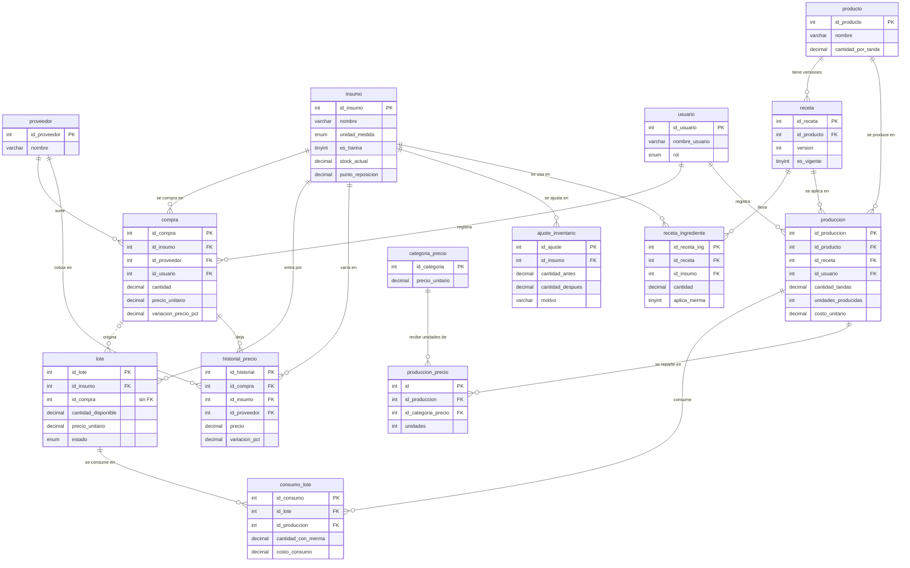
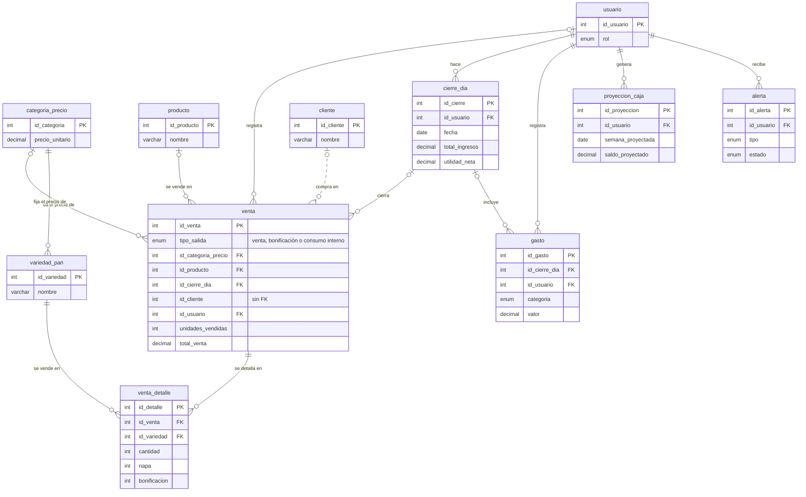
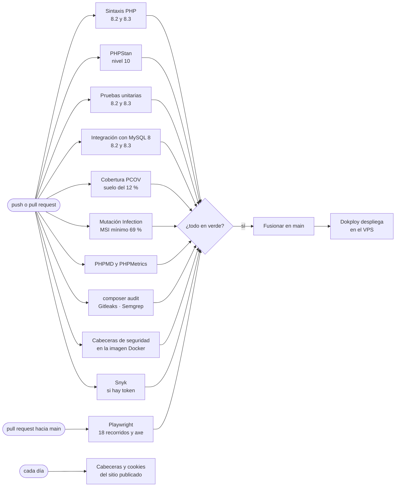

# Diagramas — BreadControl

Estos diagramas se dibujaron el **2026-09-14** a partir del esquema real
(`sql/init/01_esquema_base.sql`, consultado sobre una base recién creada con
`information_schema`) y del código de los modelos. GitHub los dibuja directamente.

**Si cambias el esquema, actualiza el diagrama en el mismo PR.** Un diagrama desactualizado es peor que no tenerlo: se cree.

## Contenido

1. [Modelo entidad-relación](#1-modelo-entidad-relación)
2. [Integración continua](#2-integración-continua)

La arquitectura por capas está en el [README](../README.md#-arquitectura).

---

## 1. Modelo entidad-relación

La base tiene **24 tablas y 6 vistas**. Para que se pueda leer, el modelo se
divide en dos dominios; `categoria_precio`, `variedad_pan` y `usuario` aparecen
en más de uno porque los unen.

**Cómo se lee:**

- Línea **continua**: clave foránea real, la base la garantiza.
- Línea **punteada**: relación que el código usa pero que la base **no** garantiza
  (no hay clave foránea). Ver [la tabla del final](#relaciones-sin-clave-foránea).
- `||` exactamente uno · `|o` cero o uno · `o{` cero o muchos.

### 1.1 Inventario y producción

Casi todas las tablas operativas guardan `id_usuario` (quién registró). Para que el
diagrama se lea, esa relación solo se dibuja en `compra` y `produccion`.

**FIFO:** una producción descuenta los insumos de los lotes más antiguos primero, y
cada descuento queda en `consumo_lote` con su costo. Así el costo de una producción
es el de los lotes que de verdad consumió, no un precio promedio.

### 1.2 Ventas, caja y administración

### Tablas sin relaciones y vistas

| Objeto | Para qué |
|---|---|
| `intento_login` | Intentos fallidos de acceso y de recuperación (`ambito`, `identificador`, `ip`, `fecha`). No referencia cuentas a propósito: también registra intentos contra usuarios que no existen |
| `migracion` | Qué migraciones tiene aplicadas esta base. La crea `sql/migraciones/2026-08-20_01_control_migraciones.sql`, no el esquema base |
| `v_inventario_actual`, `v_insumos_alerta`, `v_lotes_fifo` | Stock, alertas y lotes disponibles en orden FIFO |
| `v_margen_productos`, `v_resumen_financiero_30d`, `v_stock_productos_hoy` | Margen por producto, finanzas de 30 días y stock del día |

### Relaciones sin clave foránea

Estas dos relaciones las usa el código, pero la base no impide que apunten a una
fila inexistente. Se dejan anotadas porque son las primeras candidatas si algún día
se endurece la integridad del esquema.

| Columna | Apunta a | Qué pasa si queda huérfana |
|---|---|---|
| `lote.id_compra` | `compra` | Se pierde la trazabilidad de qué compra originó el lote |
| `venta.id_cliente` | `cliente` | La venta queda sin cliente asociado |

---

## 2. Integración continua

Once verificaciones en cada push y pull request, más la comprobación diaria del
sitio publicado. El detalle de lo que exige cada una está en el
[README](../README.md#-integración-continua) y el razonamiento de sus umbrales en
[`estrategia_pruebas.md`](estrategia_pruebas.md).

